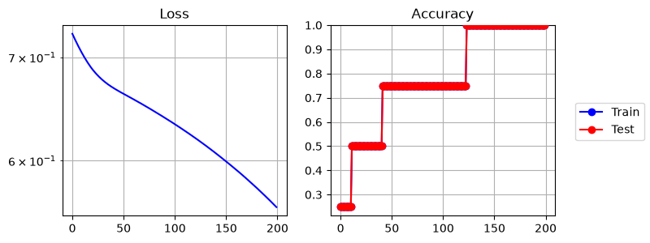
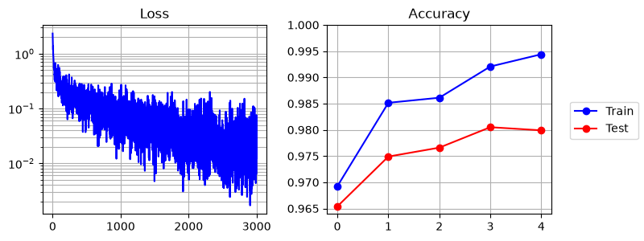
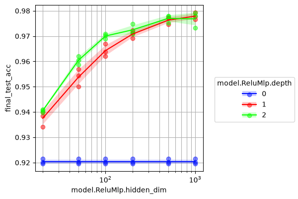
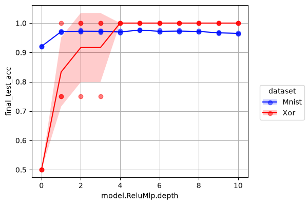
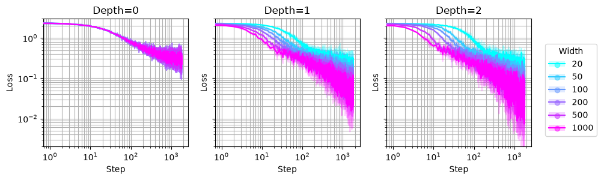

# JUML

A Judicious, Unified, extendable, paradigm-agnostic framework for Machine Learning research, powered by [`jutility`](https://github.com/jakelevi1996/jutility) and [PyTorch](https://pytorch.org/).

> *[Judicious [adjective]: having or showing reason and good judgment in making decisions](https://dictionary.cambridge.org/dictionary/english/judicious)*


## Contents

- [JUML](#juml)
  - [Contents](#contents)
  - [Installation](#installation)
  - [Overview](#overview)
  - [Usage examples](#usage-examples)
  - [Extension guide](#extension-guide)
    - [Overview](#overview-1)
    - [Define models](#define-models)
    - [Define datasets](#define-datasets)
    - [Define commands](#define-commands)
    - [Define framework](#define-framework)
  - [Extra tips](#extra-tips)
  - [Citation](#citation)

## Installation

JUML is available as [a Python package on PyPI](https://pypi.org/project/juml-framework/), and can be installed using `pip` with the following commands:

```
python -m pip install -U pip
python -m pip install -U juml-framework
```

JUML can be installed with the latest updates from GitHub:

```
python -m pip install -U pip
python -m pip install git+https://github.com/jakelevi1996/juml.git --force-reinstall --no-deps
```

Alternatively, JUML can be installed in "editable mode" from the [GitHub repository](https://github.com/jakelevi1996/juml):

```
git clone https://github.com/jakelevi1996/juml.git
cd juml
python -m pip install -U pip
python -m pip install -e .
```

JUML depends on [PyTorch](https://pytorch.org/). The installation instructions for PyTorch depend on which (if any) CUDA version is available, so PyTorch won't be automatically installed by `pip` when installing JUML. Instead, please install PyTorch following the [official PyTorch installation instructions](https://pytorch.org/get-started/locally/).

## Overview

The purpose of JUML is to make the process of running ML experiments smoother.

For example, as described in more detail in the [Extension guide](#extension-guide), when starting a new project, all you have to do is:

- Appropriately define one or more training loops, models, and datasets (or RL environments)
- Define subclasses of [`Framework`](https://github.com/jakelevi1996/juml/blob/main/src/juml/framework.py) and [`Sweep`](https://github.com/jakelevi1996/juml/blob/main/src/juml/commands/sweep.py), and override one method in each of those subclasses
- Configure your `pyproject.toml` file appropriately

Then, JUML will automatically provide you with:

- A CLI, including configurable selection and automatic nested initialisation of objects and subcommands (without having to write any config files)
- Automatic results directory naming, so you don't have to worry about results overwriting each other, or manually naming each results file, or writing code to do this yourself, or paying a subscription for an external tool
- Automatic sweeping over multiple parameters simultaneously and plotting sweep results *from the command line* (without having to write any extra sweeping code)
- (and possibly more features to be added in future)

## Usage examples

Once you install JUML, you can run a few commands and experiments from the command-line, without having to write any code.

First of all, view the top-level and command-specific help interfaces:

```
juml -h
juml TrainClassification -h
juml Sweep -h
```

Train an MLP on XOR to 100% accuracy in under 1 second (CPU):

```
juml TrainClassification \
    --dataset Xor \
    --model ReluMlp \
    --model.ReluMlp.hidden_dim 10 \
    --epochs 200
```

```
cli: Xor()
cli: ReluMlp(depth=1, hidden_dim=10, input_dim=2, output_dim=2)
cli: DeviceConfig(gpu=False, visible_devices=[])
Count | Time        | Epoch      | Batch      | Loss       | Train acc  | Test acc
----- | ----------- | ---------- | ---------- | ---------- | ---------- | ----------
0     | 0.1796s     |          0 |          0 |    0.72485 |            |
0     | 0.1796s     |          0 |          0 |    0.72485 |            |
1     | 0.1801s     |          0 |            |            |    0.25000 |    0.25000
...
398   | 0.2665s     |        199 |          0 |    0.55982 |            |
399   | 0.2667s     |        199 |            |            |    1.00000 |    1.00000
Saving in "results/trainclassification/b100dXe200mRmd1mh10s0/args.json"
Saving in "results/trainclassification/b100dXe200mRmd1mh10s0/cmd.txt"
Saving in "results/trainclassification/b100dXe200mRmd1mh10s0/table.pkl"
Saving in "results/trainclassification/b100dXe200mRmd1mh10s0/metrics.json"
Saving in "results/trainclassification/b100dXe200mRmd1mh10s0/metrics.png"
Time taken for `TrainClassification` = 0.5965 seconds
```



Train an MLP on MNIST to 98% test accuracy in under 30 seconds (CPU):

```
juml TrainClassification \
    --dataset Mnist \
    --model ReluMlp \
    --model.ReluMlp.hidden_dim 1000 \
    --epochs 5
```

```
cli: Mnist()
cli: ReluMlp(depth=1, hidden_dim=1000, input_dim=784, output_dim=10)
cli: DeviceConfig(gpu=False, visible_devices=[])
Count | Time        | Epoch      | Batch      | Loss       | Train acc  | Test acc
----- | ----------- | ---------- | ---------- | ---------- | ---------- | ----------
0     | 0.2381s     |          0 |          0 |    2.33933 |            |
165   | 1.0033s     |          0 |        165 |    0.23473 |            |
515   | 2.0012s     |          0 |        515 |    0.14962 |            |
599   | 2.2364s     |          0 |        599 |    0.05567 |            |
600   | 3.6071s     |          0 |            |            |    0.96902 |    0.96540
601   | 3.6106s     |          1 |          0 |    0.06847 |            |
740   | 4.0008s     |          1 |        139 |    0.08200 |            |
1095  | 5.0017s     |          1 |        494 |    0.02998 |            |
1200  | 5.2969s     |          1 |        599 |    0.05450 |            |
1201  | 6.6441s     |          1 |            |            |    0.98487 |    0.97540
1202  | 6.6476s     |          2 |          0 |    0.02625 |            |
1327  | 7.0009s     |          2 |        125 |    0.05536 |            |
1670  | 8.0008s     |          2 |        468 |    0.07023 |            |
1801  | 8.4322s     |          2 |        599 |    0.05022 |            |
1802  | 9.7925s     |          2 |            |            |    0.98570 |    0.97610
1803  | 9.7963s     |          3 |          0 |    0.03761 |            |
1872  | 10.0011s    |          3 |         69 |    0.02156 |            |
2225  | 11.0021s    |          3 |        422 |    0.05112 |            |
2402  | 11.5221s    |          3 |        599 |    0.03530 |            |
2403  | 12.8423s    |          3 |            |            |    0.99327 |    0.98090
2404  | 12.8461s    |          4 |          0 |    0.02854 |            |
2457  | 13.0013s    |          4 |         53 |    0.02315 |            |
2824  | 14.0006s    |          4 |        420 |    0.02309 |            |
3003  | 14.4822s    |          4 |        599 |    0.02862 |            |
3004  | 15.8258s    |          4 |            |            |    0.99525 |    0.98130
Saving in "results/trainclassification/b100dMe5mRmd1mh1000s0/args.json"
Saving in "results/trainclassification/b100dMe5mRmd1mh1000s0/cmd.txt"
Saving in "results/trainclassification/b100dMe5mRmd1mh1000s0/table.pkl"
Saving in "results/trainclassification/b100dMe5mRmd1mh1000s0/metrics.json"
Saving in "results/trainclassification/b100dMe5mRmd1mh1000s0/metrics.png"
Time taken for `TrainClassification` = 16.2295 seconds
```



Sweep over width, depth, and random seeds for the MLP:

```
juml Sweep \
    --params '{
        "seed": [0, 1, 2],
        "model.ReluMlp.hidden_dim": [20, 50, 100, 200, 500, 1000],
        "model.ReluMlp.depth": [0, 1, 2]
    }' \
    --PlottingConfig.x_key model.ReluMlp.hidden_dim \
    --PlottingConfig.y_key final_test_acc \
    --PlottingConfig.c_key model.ReluMlp.depth \
    --PlottingConfig.log_x \
    TrainClassification \
    --dataset Mnist \
    --model ReluMlp \
    --epochs 3
```

This trains 54 models in ~12 minutes, and produces the following graph:



Tidy up the labels and colour scheme by using the appropriate `--PlottingConfig` arguments. We also provide the `--name` argument to the `Sweep` command, because although `Sweep` automatically names output directories, it will overwrite our previous graph if we only change `--PlottingConfig` arguments. The results will automatically be loaded from disk without rerunning the experiments unless we specify `Sweep --force_run`:

```
juml Sweep \
    --params '{
        "seed": [0, 1, 2],
        "model.ReluMlp.hidden_dim": [20, 50, 100, 200, 500, 1000],
        "model.ReluMlp.depth": [0, 1, 2]
    }' \
    --name tidy_mnist_sweep \
    --PlottingConfig.x_key model.ReluMlp.hidden_dim \
    --PlottingConfig.y_key final_test_acc \
    --PlottingConfig.c_key model.ReluMlp.depth \
    --PlottingConfig.log_x \
    --PlottingConfig.x_label Width \
    --PlottingConfig.y_label 'Test acc' \
    --PlottingConfig.c_label Depth \
    --PlottingConfig.ylim 0.9 1 \
    --PlottingConfig.cool_colours \
    TrainClassification \
    --dataset Mnist \
    --model ReluMlp \
    --epochs 3
```


We can transpose the axes of the graph simply by swapping `--PlottingConfig` arguments and choosing a new name:

```
juml Sweep \
    --params '{
        "seed": [0, 1, 2],
        "model.ReluMlp.hidden_dim": [20, 50, 100, 200, 500, 1000],
        "model.ReluMlp.depth": [0, 1, 2]
    }' \
    --name tidy_mnist_sweep_transpose \
    --PlottingConfig.x_key model.ReluMlp.depth \
    --PlottingConfig.y_key final_test_acc \
    --PlottingConfig.c_key model.ReluMlp.hidden_dim \
    --PlottingConfig.x_label Depth \
    --PlottingConfig.y_label 'Test acc' \
    --PlottingConfig.c_label Width \
    --PlottingConfig.ylim 0.9 1 \
    --PlottingConfig.cool_colours \
    TrainClassification \
    --dataset Mnist \
    --model ReluMlp \
    --epochs 3
```


The `--depends` argument to `Sweep` can be use to make some parameters depend functionally on other parameters being swept over by specifying a value mapping. For example, suppose we want to sweep over `model.ReluMlp.depth` for 2 datasets `Mnist` and `Xor`, but we want to use different numbers of epochs and hidden dimension for each dataset:

```
juml Sweep \
    --params '{
        "seed": [0, 1, 2],
        "model.ReluMlp.depth": [0, 1, 2, 3, 4, 5, 6, 7, 8, 9, 10],
        "dataset": ["Mnist", "Xor"]
    }' \
    --depends '{
        "dataset:epochs": {"Mnist": 3, "Xor": 200},
        "dataset:model.ReluMlp.hidden_dim": {"Mnist": 200, "Xor": 10}
    }' \
    --PlottingConfig.x_key model.ReluMlp.depth \
    --PlottingConfig.y_key final_test_acc \
    --PlottingConfig.c_key dataset \
    TrainClassification \
    --model ReluMlp
```



Compare learning curves for models with different widths and depths:

```
juml CompareLearningCurves \
    --params '{
        "seed": [0, 1, 2],
        "model.ReluMlp.hidden_dim": [20, 50, 100, 200, 500, 1000],
        "model.ReluMlp.depth": [0, 1, 2]
    }' \
    --PlottingConfig.y_key loss \
    --PlottingConfig.c_key model.ReluMlp.hidden_dim \
    --PlottingConfig.col_key model.ReluMlp.depth \
    --PlottingConfig.log_x \
    --PlottingConfig.log_y \
    --PlottingConfig.sharey \
    --PlottingConfig.ylim 2e-3 3 \
    --PlottingConfig.x_label Step \
    --PlottingConfig.y_label Loss \
    --PlottingConfig.c_label Width \
    --PlottingConfig.col_label Depth \
    --PlottingConfig.cool_colours \
    --PlottingConfig.figsize 10 3 \
    TrainClassification \
    --dataset Mnist \
    --model ReluMlp \
    --epochs 3
```



## Extension guide

### Overview

JUML is designed to be both extendable and flexible. Here we provide a guide for extending JUML in your project, step by step. You don't have to do everything in this guide (for example, you could skip defining your own datasets and just use dataset wrappers already built into JUML), and you can do more than we outline here (for example, instead of defining datasets, you could create wrappers for RL environments).

In this guide, we provide template code structures that can be copied and pasted into your repository, as well as links to concrete examples within the [JUML source code](https://github.com/jakelevi1996/juml/tree/main/src/juml). We use `ALLCAPS` to denote placeholder names, which should be replaced by descriptive names that are relevant to your project.

After following this guide, your file structure should look something like this:

```
src/
├─ MYPROJ/
   ├─ models/
      ├─ __init__.py
      ├─ INTERFACE.py
      ├─ MODEL_1.py
      ├─ MODEL_2.py
      ├─ ...
   ├─ data/
      ├─ __init__.py
      ├─ INTERFACE.py
      ├─ DATASET_1.py
      ├─ DATASET_2.py
      ├─ ...
   ├─ commands/
      ├─ __init__.py
      ├─ COMMAND_1.py
      ├─ COMMAND_2.py
      ├─ ...
      ├─ sweep.py
   ├─ __init__.py
   ├─ framework.py
pyproject.toml
```

### Define models

Start by defining an interface class for your models in `src/MYPROJ/models/INTERFACE.py` which is a subclass of [`juml.models.Model`](https://github.com/jakelevi1996/juml/blob/main/src/juml/models/model.py) (see [`juml.models.FeedForwardModel`](https://github.com/jakelevi1996/juml/blob/main/src/juml/models/ff.py) for an example):

```python
import torch
import juml

class MODEL_INTERFACE(juml.models.Model):
    def forward(self, x: torch.Tensor) -> torch.Tensor:
        raise NotImplementedError()

    def step(self, x: torch.Tensor, t: torch.Tensor) -> float:
        raise NotImplementedError()

    ...
```

Define some model classes in `src/MYPROJ/models/MODEL_1.py`, `src/MYPROJ/models/MODEL_2.py`, `...` which are subclasses of your model interface class (see [`juml.models.ReluMlp`](https://github.com/jakelevi1996/juml/blob/main/src/juml/models/relu_mlp.py) for an example):

```python
import torch
import juml
from jutility import cli
from MYPROJ.models.INTERFACE import MODEL_INTERFACE

class MODEL_1(MODEL_INTERFACE):
    def __init__(
        self,
        input_shape:    list[int],
        output_shape:   list[int],
        param_1:        int,
        param_2:        int,
        ...
    ):
        self._torch_module_init()
        ...

    def forward(self, x: torch.Tensor) -> torch.Tensor:
        y = ...
        return y

    def step(self, x: torch.Tensor, t: torch.Tensor) -> float:
        loss = ...
        return loss

    ...

    @classmethod
    def get_cli_options(cls) -> list[cli.Arg]:
        return [
            cli.Arg("param_1",  type=int, default=37),
            cli.Arg("param_2",  type=int, default=42),
            ...
        ]
```

Define a function `get_all_models` in `src/MYPROJ/models/__init__.py` which returns a list of your defined model classes (see [`juml.models.get_all_models`](https://github.com/jakelevi1996/juml/blob/main/src/juml/models/__init__.py) for an example):

```python
from MYPROJ.models.INTERFACE import MODEL_INTERFACE
from MYPROJ.models.MODEL_1 import MODEL_1
from MYPROJ.models.MODEL_2 import MODEL_2
...

def get_all_models() -> list[type[MODEL_INTERFACE]]:
    return [
        MODEL_1,
        MODEL_2,
        ...
    ]
```

### Define datasets

Define an interface class for your datasets in `src/MYPROJ/data/INTERFACE.py`, which is a subclass of [`juml.data.Dataset`](https://github.com/jakelevi1996/juml/blob/main/src/juml/data/dataset.py) (see [`juml.data.ClassificationDataset`](https://github.com/jakelevi1996/juml/blob/main/src/juml/data/classification.py) for an example):

```python
import torch
import juml

class DATASET_INTERFACE(juml.data.Dataset):
    def get_input_shape(self) -> list[int]:
        raise NotImplementedError()

    def get_output_shape(self) -> list[int]:
        raise NotImplementedError()

    ...
```

Define some dataset classes in `src/MYPROJ/data/DATASET_1.py`, `src/MYPROJ/data/DATASET_2.py`, `...` which are subclasses of your dataset interface class (see [`juml.data.Mnist`](https://github.com/jakelevi1996/juml/blob/main/src/juml/data/mnist.py) for an example):

```python
import torch
import torch.utils.data
import juml
from jutility import cli
from MYPROJ.data.INTERFACE import DATASET_INTERFACE

class DATASET_1(DATASET_INTERFACE):
    def __init__(
        self,
        param_1: int,
        param_2: int,
        ...
    ):
        ...

    def get_split(self, split: str) -> torch.utils.data.Dataset:
        split = ...
        return split

    def get_input_shape(self) -> list[int]:
        return [1, 28, 28]

    def get_output_shape(self) -> list[int]:
        return [10]

    ...

    @classmethod
    def get_cli_options(cls) -> list[cli.Arg]:
        return [
            cli.Arg("param_1",  type=int, default=37),
            cli.Arg("param_2",  type=int, default=42),
            ...
        ]
```

Define a function `get_all_datasets` in `src/MYPROJ/data/__init__.py` which returns a list of your defined dataset classes (see [`juml.data.get_all_datasets`](https://github.com/jakelevi1996/juml/blob/main/src/juml/data/__init__.py) for an example):

```python
from MYPROJ.data.INTERFACE import DATASET_INTERFACE
from MYPROJ.data.DATASET_1 import DATASET_1
from MYPROJ.data.DATASET_2 import DATASET_2
...

def get_all_datasets() -> list[type[DATASET_INTERFACE]]:
    return [
        DATASET_1,
        DATASET_2,
        ...
    ]
```

### Define commands

Define some training loops or other commands in `src/MYPROJ/commands/COMMAND_1`, `src/MYPROJ/commands/COMMAND_2`, `...`, which are subclasses of [`juml.commands.Command`](https://github.com/jakelevi1996/juml/blob/main/src/juml/commands/command.py), and override the `run` and `get_cli_args` methods (see [`juml.commands.TrainClassification`](https://github.com/jakelevi1996/juml/blob/main/src/juml/commands/train_classification.py) for an example):

```python
import torch
import juml
from jutility import plotting, util, cli
from MYPROJ.data import DATASET_INTERFACE, get_all_datasets
from MYPROJ.models import MODEL_INTERFACE, get_all_models

class COMMAND_1(juml.commands.Command):
    def run(
        self,
        seed:       int,
        epochs:     int,
        batch_size: int,
        ...
    ):
        torch.manual_seed(seed)

        dataset = self.init_object("dataset")
        assert isinstance(dataset, DATASET_INTERFACE)

        model = self.init_object(
            "model",
            input_shape=dataset.get_input_shape(),
            output_shape=dataset.get_output_shape(),
        )
        assert isinstance(model, MODEL_INTERFACE)

        device_cfg = self.init_object("DeviceConfig")
        assert isinstance(device_cfg, juml.DeviceConfig)

        device_cfg.set_module_device(model)

        train_loader = dataset.get_data_loader("train", batch_size)
        test_loader  = dataset.get_data_loader("test",  batch_size)

        for e in range(epochs):
            for b, (x, t) in enumerate(train_loader):
                x, t = device_cfg.set_tensor_device(x, t)
                loss = model.step(x, t)
                ...

        self.save_args()
        self.save_metrics(
            final_train_loss=...
            final_train_acc=...
            final_test_acc=...
            time=...
        )

    @classmethod
    def get_cli_args(cls) -> list[cli.Arg]:
        return [
            cli.Arg("seed",         type=int,   default=0),
            cli.Arg("epochs",       type=int,   default=1),
            cli.Arg("batch_size",   type=int,   default=100),
            ...
            juml.DeviceConfig.get_cli_arg(),
            cli.ObjectChoice(
                "dataset",
                *[
                    dataset_type.get_cli_arg()
                    for dataset_type in get_all_datasets()
                ],
                is_group=True,
            ),
            cli.ObjectChoice(
                "model",
                *[
                    model_type.get_cli_arg()
                    for model_type in get_all_models()
                ],
                is_group=True,
            ),
        ]
```

Define a class `Sweep` in `src/MYPROJ/commands/sweep.py` which is a subclass of [`juml.commands.Sweep`](https://github.com/jakelevi1996/juml/blob/main/src/juml/commands/sweep.py), override the class-method `get_subcommands`, and from it return a list of your defined command classes (NOT including your `Sweep` subclass itself):

```python
import juml
from MYPROJ.commands.COMMAND_1 import COMMAND_1
from MYPROJ.commands.COMMAND_2 import COMMAND_2
...

class Sweep(juml.commands.Sweep):
    @classmethod
    def get_subcommands(cls) -> list[type[juml.commands.Command]]:
        return [
            COMMAND_1,
            COMMAND_2,
            ...
        ]
```

Define a function `get_all_commands` in `src/MYPROJ/commands/__init__.py` which returns a list of your defined command classes, including your `Sweep` subclass (see [`juml.commands.get_all_commands`](https://github.com/jakelevi1996/juml/blob/main/src/juml/commands/__init__.py) for an example):

```python
import juml
from MYPROJ.commands.COMMAND_1 import COMMAND_1
from MYPROJ.commands.COMMAND_2 import COMMAND_2
...
from MYPROJ.commands.sweep import Sweep

def get_all_commands() -> list[type[juml.commands.Command]]:
    return [
        COMMAND_1,
        COMMAND_2,
        ...
        Sweep,
    ]
```

### Define framework

Define a class `Framework` in the file `src/MYPROJ/framework.py` which is a subclass of [`juml.Framework`](https://github.com/jakelevi1996/juml/blob/main/src/juml/framework.py), override the class-method `get_commands`, and from it return the output from your `get_all_commands` function:

```python
import juml
from MYPROJ.commands import get_all_commands

class Framework(juml.Framework):
    @classmethod
    def get_commands(cls) -> list[type[juml.commands.Command]]:
        return get_all_commands()
```

Define the namespace for your package in `src/MYPROJ/__init__.py`:

```python
from MYPROJ import (
    models,
    data,
    commands,
)
from MYPROJ.framework import Framework
```

Make a file `pyproject.toml` with the following template:

```
[build-system]
requires = ["setuptools>=61.0"]
build-backend = "setuptools.build_meta"

[project]
name = "MYPROJ"
version = "0.0.1"

[project.scripts]
MYPROJ = "MYPROJ.framework:Framework.run"
```

Run the following commands to update `pip` and install your project:

```
python -m pip install -U pip
python -m pip install -e .
```

Now you are ready to run some commands and sweeps! For example:

```
MYPROJ COMMAND_1 ...
MYPROJ Sweep --params '{...}' ... COMMAND_1 ...`
```

## Extra tips

There are different approaches that can be taken to debugging. Perhaps the easiest is to make a new Python script which calls `juml.Framework.run` (or your subclass of `Framework`) directly with specified arguments, and then debug this like a normal script, for example:

```py
import juml
import shlex

s = """
    TrainClassification \
    --dataset Mnist \
    --model ReluMlp \
    --model.ReluMlp.hidden_dim 1000 \
    --epochs 1
"""
juml.Framework.run(shlex.split(s))
```

Sometimes you may want to make more sophisticated plots beyond those produced by `juml Sweep` (or your subclass of `Sweep`), which involves iterating over arguments and loading saved metrics. Every subclass of [`juml.commands.Command`](https://github.com/jakelevi1996/juml/blob/main/src/juml/commands/command.py) inherits a class method `load_metric_from_args`, to which you can simply provide a dictionary of arguments (for example those saved in [`args.json`](https://github.com/jakelevi1996/juml/blob/main/results/trainclassification/b100dMdfTe5mRmd2mh1000s0/args.json) by your training command) and the name of the metric you want to load. Then `load_metric_from_args` will load that metric for you. For example:

```py
m = juml.commands.TrainClassification.load_metric_from_args(
    arg_dict={
        "seed": 0,
        "epochs": 5,
        "batch_size": 100,
        "dataset": "Mnist",
        "model": "ReluMlp",
        "model.ReluMlp.depth": 1,
        "model.ReluMlp.hidden_dim": 1000
    },
    name="final_test_acc",
)
print(m)
# >>> 0.9818000197410583
```

## Citation

If you find JUML helpful in your research, please cite:

```
@misc{levi_juml_2025,
    title = {{JUML}: {A} {Judicious}, {Unified}, extendable, paradigm-agnostic framework for {Machine} {Learning} research},
    shorttitle = {{JUML}},
    url = {https://github.com/jakelevi1996/juml},
    abstract = {A Judicious, Unified, extendable, paradigm-agnostic framework for Machine Learning research, powered by jutility and PyTorch.},
    author = {Levi, Jake},
    year = {2025},
}
```
